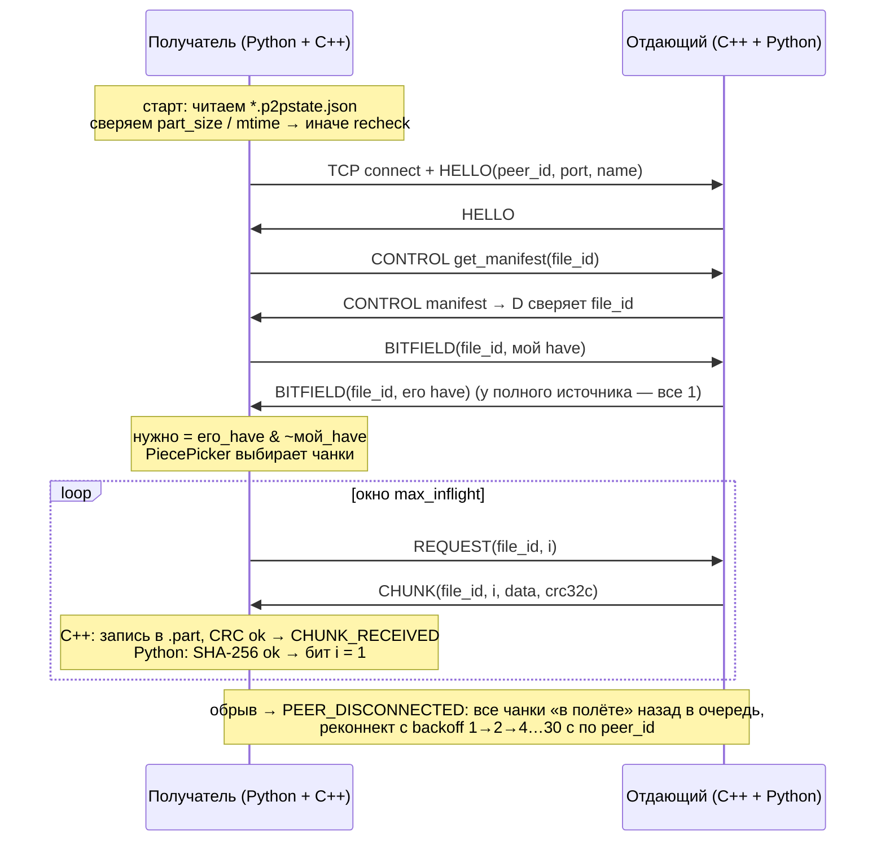

# P2P Share — архитектура и дорожная карта

Семестровая работа, тема №11 «Система передачи файлов по технологии P2P» (2 курс, Python, работа в паре).

## 0. Исходное ТЗ (из «Темы семестровых работ.docx»)

> Разработать приложение для прямого обмена файлами между двумя или несколькими компьютерами без централизованного файлового сервера.

| Возможная функция | Где реализуется |
|---|---|
| Поиск узлов в локальной сети и установление соединения | Python (discovery) + C++ (TCP-соединение, рукопожатие) |
| Передача больших файлов частями | C++ (протокол, чанки, буферы) |
| Отображение прогресса передачи | C++ (счётчики, события) → Python (UI) |
| Продолжение загрузки после разрыва соединения | Python (состояние, bitfield на диске) + C++ (обмен BITFIELD) |
| Проверка целостности полученных файлов | Python (SHA-256 чанков и файла) + C++ (CRC32C кадров) |
| **\*** C++: сетевой протокол и передача блоков данных | `cpp/` → модуль `p2pshare._p2pcore` |
| **\*\*** Курсовая: скачивание частей файла у нескольких пользователей, распределённое скачивание и поиск узлов | заложено: content-addressed `file_id`, bitfield на пару (пир, файл), планировщик чанков в Python, `HAVE` в протоколе |

Тестовая ОС — Windows 10/11 (основная), Linux — желательно (CI, санитайзеры).

---

## 1. Разделение ответственности

Главный принцип: **C++ — механизм, Python — политика.**
C++ умеет быстро и надёжно «перекачать чанк №N файла X по соединению C». Python решает, *какой* чанк, *у кого*, *когда*, и что делать с результатом.

```
┌───────────────────────────── Python (p2pshare) ──────────────────────────────┐
│  UI (Textual TUI / CLI)            ←  CoreEvent (asyncio)                    │
│  ───────────────────────────────────────────────────────────────────────────  │
│  AppCore                                                                      │
│   ├─ Discovery (UDP multicast/broadcast, zeroconf опц.) → PeerTable           │
│   ├─ ConnectionManager (кому подключаться, реконнект с backoff)               │
│   ├─ Catalog (свои раздачи, построение манифестов, SHA-256)                   │
│   ├─ TransferManager → DownloadTask (машина состояний) → PiecePicker          │
│   ├─ Verifier (SHA-256 чанков, пул потоков)                                   │
│   ├─ StateStore (.p2pstate.json — bitfield для докачки)                       │
│   └─ EventPump  ← engine.wait_events()  (GIL отпущен внутри C++)              │
├──────────────────────── граница: pybind11, модуль _p2pcore ───────────────────┤
│  C++ (p2pcore)                                                                │
│   Engine (фасад, потокобезопасный API) ── asio::post ──► io-поток             │
│   ├─ Acceptor / Connection (TCP, рукопожатие, keepalive, очереди отправки)    │
│   ├─ FrameCodec (40-байтный заголовок, big-endian, CRC32C)                    │
│   ├─ FileRegistry / PositionalFile (pread/pwrite, фиксированные буферы)       │
│   ├─ Bitfield (рабочая копия «что я могу отдавать»)                           │
│   ├─ RateLimiter (token bucket: глобальный + на соединение)                   │
│   └─ EventQueue (mutex+condvar, коалесцирование прогресса)                    │
└───────────────────────────────────────────────────────────────────────────────┘
```

### 1.1. Что делает C++

| Область | Детали |
|---|---|
| Сокеты | TCP-сервер (accept), исходящие подключения, таймауты, keepalive (PING каждые 5 с, разрыв после 15 с тишины) |
| Протокол | Кодирование/декодирование кадров, рукопожатие `HELLO`, проверка magic/версии/длины, защита от «мусора» |
| Чанки | Отдача чанков по `REQUEST`, приём `CHUNK` потоково через буфер 64 КиБ прямо в файл по смещению |
| Память | Пул фиксированных буферов; память на соединение ограничена `окно × размер буфера`, файл целиком в ОЗУ не грузится никогда |
| Скорость/потоки | Token bucket (лимиты отдачи/приёма), окно запросов в полёте (pipelining), backpressure |
| Целостность транспорта | CRC32C на каждый кадр (ловит ошибки работы с буферами ещё в C++) |
| Прогресс | Счётчики байт на передачу, события `PROGRESS` не чаще 10 Гц |

### 1.2. Что делает Python

| Область | Детали |
|---|---|
| Discovery | UDP multicast + broadcast, `ANNOUNCE`/`QUERY`, таблица пиров с TTL, ручное добавление `ip:port` |
| Состояние загрузок | Машина состояний `DownloadTask`, очередь, пауза/возобновление, реконнект |
| Метаданные | Манифест (имя, размер, размер чанка, SHA-256 каждого чанка и всего файла), `file_id` |
| Докачка | `.p2pstate.json` с bitfield, атомарная запись, recheck по хэшам при потере состояния |
| Целостность содержимого | SHA-256 каждого чанка до установки бита + SHA-256 всего файла в конце |
| Планирование | `PiecePicker`: какие чанки запрашивать и у кого (сейчас — последовательно, в курсовой — rarest-first) |
| UI | Textual TUI + CLI-команды для отладки и демо |

> Почему SHA-256 в Python не тормозит: `hashlib` (OpenSSL, SHA-NI) даёт 1–2 ГБ/с и **сам отпускает GIL** для буферов > 2 КиБ. Гигабитная сеть — ~115 МБ/с. Узкое место будет сеть, а не хэш.

### 1.3. Связка Python ↔ C++: pybind11

| Вариант | За | Против | Вердикт |
|---|---|---|---|
| **pybind11** | Больше всего документации и примеров, `call_guard<gil_scoped_release>`, `stl.h`, `stl/filesystem.h`, исключения → Python | Чуть медленнее компиляция, крупнее бинарник | **Берём** |
| nanobind | Быстрее, компактнее, тот же автор | Меньше примеров, строже к типам; для учебного проекта выигрыш не ощутим | Допустимая замена (API почти 1:1, `nb::gil_scoped_release`) |
| ctypes | Без компиляции обёрток | Ручной C-ABI, ручное управление памятью, нет исключений и классов, коллбэки через `CFUNCTYPE` — источник крашей | Нет |

Сборка — **scikit-build-core** (CMake как бэкенд `pip install`), модуль получает имя `p2pshare._p2pcore`.

### 1.4. GIL: правила, которые нужно соблюдать

**Правило 1. Каждый метод, который может ждать (сеть, диск, condvar), отпускает GIL.**

```cpp
.def("connect", &Engine::connect,
     py::arg("host"), py::arg("port"), py::arg("timeout_ms") = 5000,
     py::call_guard<py::gil_scoped_release>())
```

`call_guard` отпускает GIL только на время вызова C++-функции: аргументы конвертируются **до**, возвращаемое значение — **после** (уже под GIL). Поэтому `std::string`, `std::vector<uint32_t>`, `std::filesystem::path`, `std::vector<Event>` в сигнатуре безопасны, а `py::object`/`py::bytes`/`py::function` **внутри** такой функции трогать нельзя.

Если нужна тонкая настройка — отпускаем вручную в лямбде:

```cpp
.def("wait_events", [](Engine& e, int timeout_ms, std::size_t max_events) {
    std::vector<Event> out;
    {
        py::gil_scoped_release release;          // ждём на condvar без GIL
        e.wait_events(out, timeout_ms, max_events);
    }                                            // GIL снова наш
    return out;                                  // конвертация в list[Event] под GIL
}, py::arg("timeout_ms") = 100, py::arg("max_events") = 512)
```

**Правило 2. io-поток C++ не вызывает Python напрямую.** Вместо коллбэков — **очередь событий**:

```
io-поток C++ ──push──► EventQueue (mutex+condvar) ──wait_events()──► Python EventPump ──► AppCore ──► UI
```

Почему не коллбэк с `py::gil_scoped_acquire`:
1. **Дедлок при остановке**: Python держит GIL и вызывает `engine.stop()`, который делает `join()` io-потока, а io-поток в этот момент ждёт GIL, чтобы вызвать коллбэк. Лечится только отпусканием GIL в `stop()` — легко забыть.
2. **Конкуренция за GIL на каждый чанк** — UI начинает дёргаться.
3. **Время жизни `py::function`**: её деструктор тоже требует GIL; уничтожение в io-потоке без GIL — падение при выходе из программы.
4. Исключение в Python-коллбэке внутри io-потока некуда пробросить.

Если всё же нужен прямой коллбэк (например, для лога), то только так:

```cpp
.def("set_log_handler", [](Engine& e, py::function cb) {
    // деструктор py::function тоже обязан выполняться под GIL
    auto fn = std::shared_ptr<py::function>(new py::function(std::move(cb)),
        [](py::function* f) { py::gil_scoped_acquire gil; delete f; });
    e.set_log_handler([fn](int level, std::string msg) {
        py::gil_scoped_acquire gil;
        try { (*fn)(level, msg); }
        catch (py::error_already_set& err) { err.discard_as_unraisable("p2pcore log handler"); }
    });
})
```

**Правило 3. `stop()` и деструктор `Engine` — с отпущенным GIL** (`call_guard`), `stop()` идемпотентен и вызывается из `__exit__`/`atexit`.

**Правило 4. Прогресс коалесцируется в C++.** Не одно событие на каждые 64 КиБ, а одно `PROGRESS` на передачу не чаще чем раз в 100 мс (накопленные счётчики). Скорость и ETA считает Python по разнице счётчиков.

---

## 2. Сетевой протокол (C++ ядро)

### 2.1. Транспорт

- **TCP** для всего обмена данными: надёжность и порядок даёт ОС, мы занимаемся протоколом, а не переизобретаем ретрансмиссию.
- **UDP** только для discovery (Python, раздел 3.1).
- Сетевая библиотека: **standalone Asio** (header-only, без Boost). Один io-поток, асинхронные `async_read`/`async_write`, таймеры. На Windows под капотом IOCP, на Linux — epoll; писать свой реактор на Winsock/`select` не нужно — оценивать будут протокол, а не реактор.
  Учебная альтернатива — «сырые» сокеты (Winsock2/BSD), поток на соединение, блокирующие вызовы. Проще для понимания, но хуже масштабируется для курсовой (много пиров).

### 2.2. Формат кадра

Каждое сообщение = **заголовок фиксированной длины 40 байт** + полезная нагрузка `payload_len` байт. Все числа — **big-endian** (network order). Сериализация — явная побайтовая (`put_u32_be` и т.п.), **никакого `reinterpret_cast` к `#pragma pack`-структуре** (выравнивание, endianness, UB).

| Смещение | Размер | Поле | Описание |
|---:|---:|---|---|
| 0 | 4 | `magic` | `0x50325046` (`"P2PF"`) — быстрое отсечение мусора |
| 4 | 1 | `version` | `1` |
| 5 | 1 | `type` | тип сообщения, таблица ниже |
| 6 | 2 | `flags` | резерв (сжатие/шифрование в будущем), сейчас `0` |
| 8 | 16 | `file_id` | первые 16 байт `file_id` (раздел 2.5); нули для сессионных сообщений |
| 24 | 4 | `chunk_index` | индекс чанка, `0xFFFFFFFF` если неприменимо |
| 28 | 4 | `payload_len` | длина нагрузки; > `MAX_PAYLOAD` (16 МиБ) → разрыв соединения |
| 32 | 4 | `payload_crc32c` | CRC32C нагрузки (0 при пустой) |
| 36 | 4 | `seq` | номер кадра в соединении (отладка, сопоставление PING/PONG и REJECT) |

Для Python-тестов тот же заголовок: `struct.Struct(">IBBH16sIIII")` (ровно 40 байт).

```cpp
// cpp/include/p2pcore/protocol.hpp
namespace p2p {
inline constexpr std::uint32_t kMagic          = 0x50325046;  // "P2PF"
inline constexpr std::uint8_t  kProtocolVersion = 1;
inline constexpr std::size_t   kHeaderSize     = 40;
inline constexpr std::uint32_t kNoChunk        = 0xFFFFFFFF;
inline constexpr std::uint32_t kMaxPayload     = 16u << 20;

using FileId = std::array<std::uint8_t, 16>;

enum class MsgType : std::uint8_t {
    Hello = 0x01, Ping = 0x02, Pong = 0x03, Bye = 0x0F,
    Control = 0x10,
    Bitfield = 0x20, Have = 0x21,
    Request = 0x30, Chunk = 0x31, Reject = 0x32, Cancel = 0x33,
};

struct FrameHeader {
    std::uint8_t  version     = kProtocolVersion;
    MsgType       type        = MsgType::Ping;
    std::uint16_t flags       = 0;
    FileId        file_id     {};
    std::uint32_t chunk_index = kNoChunk;
    std::uint32_t payload_len = 0;
    std::uint32_t payload_crc = 0;
    std::uint32_t seq         = 0;
};

enum class DecodeError { None, BadMagic, BadVersion, PayloadTooLarge, UnknownType };

void        encode_header(const FrameHeader& h, std::span<std::uint8_t, kHeaderSize> out);
DecodeError decode_header(std::span<const std::uint8_t, kHeaderSize> in, FrameHeader& h);
}
```

### 2.3. Типы сообщений

| Код | Тип | `file_id` | `chunk_index` | Payload | Кто обрабатывает |
|---|---|:-:|:-:|---|---|
| 0x01 | `HELLO` | — | — | `peer_id[16]`, `listen_port u16`, `caps u32`, `name` (UTF-8) | C++ (рукопожатие), событие `PEER_CONNECTED` в Python |
| 0x02 / 0x03 | `PING` / `PONG` | — | — | `timestamp_ns u64` (эхо) | C++, событие `PONG` с RTT |
| 0x0F | `BYE` | — | — | `reason u16` | C++ |
| 0x10 | `CONTROL` | — | — | непрозрачные байты (UTF-8 JSON) | **Python**: C++ только доставляет |
| 0x20 | `BITFIELD` | ✓ | — | битовая карта, MSB-first, `ceil(n/8)` байт, хвостовые биты = 0 | C++ доставляет в Python + свой обязательно отдаёт по запросу |
| 0x21 | `HAVE` | ✓ | ✓ | — | курсовая (оповещение пиров о новом чанке) |
| 0x30 | `REQUEST` | ✓ | ✓ | — | C++ отвечает сам, без участия Python |
| 0x31 | `CHUNK` | ✓ | ✓ | данные чанка (последний может быть короче) | C++ пишет на диск, событие `CHUNK_RECEIVED` |
| 0x32 | `REJECT` | ✓ | ✓ | `reason u16` (`UNKNOWN_FILE`, `NOT_HAVE`, `BUSY`) | C++ → событие `CHUNK_FAILED` |
| 0x33 | `CANCEL` | ✓ | ✓ | — | C++ (снять из очереди отправки) |

Прикладные сообщения поверх `CONTROL` (их формирует и разбирает Python, C++ не меняется при их расширении):

```json
{"t": "list"}
{"t": "files", "items": [{"file_id": "9f2c…(64 hex)", "name": "film.mkv", "size": 4294967296}]}
{"t": "get_manifest", "file_id": "9f2c…"}
{"t": "manifest", "manifest": { … см. 2.5 … }}
{"t": "error", "code": "unknown_file", "file_id": "9f2c…"}
```

### 2.4. Передача больших файлов по частям

Термины: **чанк** — единица хэширования, bitfield и запроса (по умолчанию 1 МиБ); **слайс** — кусок чанка, который проходит через буфер (64 КиБ). Один `CHUNK` = один кадр, но читается и пишется слайсами.

Размер чанка выбирает Python при построении манифеста: `max(256 КиБ, next_pow2(size / 4096))`, но не больше 8 МиБ — так в манифесте не больше ~4–8 тыс. хэшей (для 4 ГБ: 4096 × 32 Б = 128 КиБ).

**Почему не `mmap`.** На Windows это `CreateFileMapping/MapViewOfFile`, ошибки диска (нет места, извлекли флешку) приходят как access violation/SIGBUS, а не как код ошибки; при записи в произвольные места нужно заранее растягивать файл. Для последовательной потоковой передачи выигрыша нет. Берём **позиционный ввод-вывод с фиксированным буфером**:

```cpp
// cpp/include/p2pcore/file_store.hpp
class PositionalFile {
public:
    static PositionalFile open_read(const std::filesystem::path& p);
    static PositionalFile open_write(const std::filesystem::path& p, std::uint64_t size); // предразмещение
    std::size_t read_at (std::uint64_t offset, std::span<std::uint8_t> buf);       // pread / ReadFile+OVERLAPPED
    void        write_at(std::uint64_t offset, std::span<const std::uint8_t> buf); // pwrite / WriteFile+OVERLAPPED
    void        flush();                                                           // fsync / FlushFileBuffers
};
```

- **Пути — `std::filesystem::path`**, а не `std::string`: на Windows `std::ifstream(std::string)` открывает файл в ANSI-кодировке и падает на кириллице в имени. pybind11 (`pybind11/stl/filesystem.h`) правильно превращает Python `str`/`Path` в широкий путь.
- **Предразмещение `.part`**: на NTFS запись далеко за концом «валидных данных» заставляет ОС синхронно занулять промежуток. Помечаем файл разрежённым (`DeviceIoControl(FSCTL_SET_SPARSE)`) и затем `SetEndOfFile`; на Linux достаточно `ftruncate`.

**Отправитель** (на `REQUEST`): проверить, что файл расшарен и бит чанка установлен → поставить в очередь отправки соединения → `async_write(header)` → цикл: `read_at(64 КиБ)` → `rate_limiter.acquire(n)` → `async_write(slice)` → следующий слайс только после завершения записи (естественный backpressure). CRC32C считается при первом чтении и кладётся в заголовок → чанк читается дважды; оптимизация — кэш CRC чанков в `FileRegistry` либо CRC в «хвостовом» кадре (флаг в `flags`), решите на этапе 4.

**Получатель**: прочитать 40 байт → `decode_header` → если `CHUNK`: проверить, что такой запрос в полёте и длина совпадает с ожидаемой → читать `payload_len` байт слайсами в буфер → обновлять CRC → `write_at(chunk_index * chunk_size + received)` → в конце сверить CRC → событие `CHUNK_RECEIVED` либо `CHUNK_FAILED(reason=CRC)`. Незапрошенный `CHUNK` = нарушение протокола → `BYE` и разрыв.

**Контроль потока**:
- окно запросов на соединение `max_inflight` (4–8 чанков) — канал не простаивает между ответом и следующим запросом;
- token bucket: `rate` байт/с, `burst` 256 КиБ; при нехватке токенов — `asio::steady_timer`, никаких busy-loop;
- память на соединение ≤ `max_inflight × 64 КиБ` на приём + 1 буфер на отправку.

**Потоки C++**: один io-поток для сети. Диск в MVP — синхронно в io-потоке (позиционная запись 64 КиБ попадает в кэш ОС и стоит микросекунды). Если на этапе 4 замеры покажут проблему — вынести диск в пул из 2 потоков. Все публичные методы `Engine` вызываются из потока Python и делают `asio::post(io_, …)`; блокирующие (`connect`, `start`) ждут `std::future` с отпущенным GIL. Состояние соединений трогает только io-поток → мьютексы нужны лишь в `EventQueue` и статистике.

### 2.5. Манифест и `file_id`

```json
{
  "version": 1,
  "name": "film.mkv",
  "info": {
    "size": 4294967296,
    "chunk_size": 1048576,
    "chunk_sha256": ["a1b2…", "…"],
    "file_sha256": "c3d4…"
  }
}
```

`file_id = SHA-256(канонический JSON поля info)` — 32 байта в манифесте, первые 16 — в заголовке кадра. Имя в `info` не входит: **`file_id` идентифицирует содержимое**, а не «файл у конкретного пира». Это та же идея, что infohash в BitTorrent, и она нужна для курсовой: один и тот же файл у трёх пиров имеет один `file_id`, а полученный от любого пира манифест проверяется пересчётом хэша.

### 2.6. Докачка (Resume) и синхронизация bitfield

**Источник правды — диск получателя**: `film.mkv.part` (предразмещён) + `film.mkv.p2pstate.json`:

```json
{
  "file_id": "9f2c…", "manifest": { … },
  "have": "base64(bitfield)",
  "part_size": 4294967296, "part_mtime_ns": 1761390000000000000,
  "peers": ["<peer_id hex>", "…"], "updated_at": "2026-10-25T12:00:00Z"
}
```

**Порядок записи (важно!)**: чанк записан → SHA-256 чанка совпал → бит установлен в памяти → раз в 2 с или каждые 32 чанка: `engine.flush(file_id)` (fsync данных) → запись `*.p2pstate.json.tmp` → `os.replace` (атомарно). Бит никогда не попадает на диск раньше данных. Худший случай после сбоя — перекачать несколько последних чанков.

**Частично принятый чанк выбрасывается**: бит не установлен — значит, чанк будет запрошен и перезаписан целиком. Смещения внутри чанка не синхронизируются, это сильно упрощает логику.

**Восстановление соединения**:



- Обрыв определяется по ошибке сокета или по таймауту keepalive (PING раз в 5 с, разрыв после 15 с тишины).
- Пир узнаётся по **`peer_id`** (UUID, хранится в конфиге и не меняется между запусками), а не по IP: после переподключения к Wi-Fi адрес может смениться, а discovery сообщит новый.
- **Recheck**: если `.p2pstate.json` пропал или не совпадает с `.part`, Python перехэширует все чанки `.part` в пуле потоков и восстановит bitfield. Медленно, но докачка не теряется.
- Чанк с неверным SHA-256 → бит не ставим, запрашиваем снова; после 3 провалов от одного пира — помечаем пира «плохим» для этого файла.
- Завершение: последний бит → SHA-256 всего файла → `engine.close_file(file_id)` (на Windows открытый файл нельзя переименовать!) → `os.replace(.part → итоговое имя)` → удалить `.p2pstate.json`.

---

## 3. Уровень приложения (Python)

### 3.1. Обнаружение пиров без центрального сервера

Собственный простой протокол поверх UDP (порт `47011`):

```json
{"magic": "P2PF-DISC", "v": 1, "type": "announce",
 "peer_id": "6f1e…", "name": "Laptop-Alice", "tcp_port": 47010, "shares": 3}
```

- `announce` — каждые 3 с; `query` — при старте («кто тут?»), все отвечают `announce` сразу, а не ждут таймера.
- Рассылка: **multicast** `239.255.42.11` (с `IP_MULTICAST_LOOP`, чтобы два экземпляра на одном ПК видели друг друга) **плюс broadcast** на широковещательный адрес каждого интерфейса (Windows часто отправляет `255.255.255.255` только в один интерфейс — Ethernet/VirtualBox/Wi-Fi).
- `PeerTable`: `peer_id → PeerInfo(addresses, name, tcp_port, last_seen, conn_id, state)`; пир удаляется после 10 с тишины (3 пропущенных анонса); свои пакеты отбрасываются по `peer_id`.
- Реализация — `asyncio.DatagramProtocol`, сокет с `SO_REUSEADDR` и `SO_BROADCAST`.
- Интерфейс `DiscoveryBackend` с двумя реализациями: `UdpDiscovery` (основная, своя — плюс на защите) и `ZeroconfDiscovery` (mDNS, сервис `_p2pshare._tcp.local.`, библиотека `zeroconf`) — опционально.
- **Ручное подключение по `ip:port` обязательно**: в университетских и гостевых Wi-Fi часто включена изоляция клиентов и broadcast режется.
- Windows Firewall при первом запуске спросит разрешение для `python.exe` — выбрать «Частные сети». Внести в README.

### 3.2. Ядро приложения

```
AppCore
 ├─ engine: _p2pcore.Engine | FakeEngine       (выбор в engine/__init__.py)
 ├─ EventPump        — asyncio-задача: await asyncio.to_thread(engine.wait_events, 100, 512)
 ├─ PeerTable / Discovery
 ├─ ConnectionManager — ленивые подключения, реконнект, дубли соединений
 ├─ Catalog          — свои раздачи: путь → манифест (хэширование в пуле с прогрессом)
 ├─ ControlProtocol  — JSON поверх CONTROL (list / files / get_manifest / manifest / error)
 ├─ TransferManager  — очередь DownloadTask, лимит одновременных загрузок
 │    └─ DownloadTask: NEW → FETCHING_MANIFEST → ALLOCATING → DOWNLOADING ⇄ STALLED
 │                     → VERIFYING → COMPLETED | FAILED | PAUSED
 ├─ PiecePicker      — стратегия выбора чанков (Sequential сейчас, RarestFirst в курсовой)
 ├─ Verifier         — ThreadPoolExecutor, SHA-256 чанка, читая его из .part
 └─ StateStore       — атомарная запись .p2pstate.json
```

Ядро ничего не знает об UI: оно публикует `CoreEvent` (dataclass) подписчикам. Поэтому TUI, CLI и, при желании, GUI — разные «морды» над одним `AppCore`, а интеграционные тесты гоняют `AppCore` без интерфейса.

Дубли соединений (оба пира подключились друг к другу одновременно): оставляем соединение, инициированное пиром с меньшим `peer_id`, второе закрываем.

### 3.3. Интерфейс: Textual (TUI) + CLI

| | **Textual** | PySide6 / PyQt6 |
|---|---|---|
| Интеграция с asyncio | **нативная**: `AppCore` живёт в том же event loop | нужен `qasync` (или экспериментальный `QtAsyncio`) |
| Прогресс-бары, таблицы, логи | `ProgressBar`, `DataTable`, `Log` из коробки | есть, но больше кода |
| Выбор файла | `DirectoryTree` (менее привычно) | `QFileDialog`, drag&drop |
| Тестирование | `App.run_test()` + `Pilot` | `pytest-qt` |
| Работает по SSH, на «голом» сервере | да | нет |
| Лицензия | MIT | PySide6 — LGPL, PyQt6 — GPL/коммерческая |

**Рекомендация: Textual** — меньше потоков и мостов между циклами событий, быстрее до работающего прогресса. Поскольку ядро UI-независимо, десктопный GUI на PySide6 + qasync можно добавить в курсовой, не трогая ядро. Плюс CLI (`p2pshare peers / ping / share / get`) — для отладки, тестов и запасного демо.

Экраны TUI: **Пиры** (имя, адрес, RTT, статус) · **Мои раздачи** · **Файлы пира** · **Передачи** (прогресс, скорость, ETA, пауза/продолжить) · **Лог**.

### 3.4. Прогресс из C++ в UI

```python
# src/p2pshare/core/event_pump.py
class EventPump:
    """Перекладывает события C++-движка в asyncio. Ожидание идёт в C++ без GIL."""

    def __init__(self, engine, dispatch):
        self._engine = engine
        self._dispatch = dispatch
        self._running = True

    async def run(self) -> None:
        while self._running:
            events = await asyncio.to_thread(self._engine.wait_events, 100, 512)
            for ev in events:
                self._dispatch(ev)
```

```python
# src/p2pshare/ui/tui/app.py
class P2PApp(App):
    async def on_mount(self) -> None:
        self.core = AppCore(self.config, listener=self._on_core_event)
        await self.core.start()

    def _on_core_event(self, ev: CoreEvent) -> None:
        self.post_message(CoreEventMessage(ev))   # тот же event loop — потоков не нужно

    def on_core_event_message(self, msg: CoreEventMessage) -> None:
        ...  # обновить ProgressBar/DataTable, перерисовка не чаще 10 Гц
```

Цепочка: C++ копит байты → раз в 100 мс `PROGRESS(transfer, bytes_done)` → `EventPump` → `DownloadTask` пересчитывает скорость (скользящее окно 3 с) и ETA → `CoreEvent` → Textual.

### 3.5. Задел под курсовую (BitTorrent-подобная загрузка)

Что закладываем **сейчас**, чтобы в курсовой не переписывать:

| Решение в семестровой | Что оно даёт курсовой |
|---|---|
| `file_id` = хэш содержимого (2.5) | один файл у N пиров распознаётся как один |
| `REQUEST` адресуется соединению, а не «файлу» | можно параллельно просить разные чанки у разных пиров |
| bitfield хранится на пару (пир, файл); `BITFIELD`/`HAVE` в протоколе с версии 1 | rarest-first, оповещение о новых чанках |
| C++ отдаёт только чанки с установленным битом (`set_have`) | частичная раздача: качаешь и сразу раздаёшь |
| `PiecePicker` — интерфейс, выбор чанков только в Python | меняется стратегия, C++ не трогаем |
| Engine с первого дня держит много соединений | рой из 5–10 пиров без переделки |
| Discovery за интерфейсом `DiscoveryBackend` | замена/дополнение на DHT (Kademlia) — «распределённый поиск узлов» |

```python
class PiecePicker(Protocol):
    def pick(self, peer_id: str, peer_have: Bitfield, my_have: Bitfield,
             in_flight: set[int], limit: int) -> list[int]: ...

class SequentialPicker:   ...  # семестровая: по порядку
class RarestFirstPicker:  ...  # курсовая: редчайшие у роя первыми, endgame-режим в конце
```

Дальнейшие темы курсовой: rarest-first + endgame, choking/unchoking (tit-for-tat), DHT, поиск файлов по имени по всей сети, шифрование канала (TLS или Noise), сравнительные замеры «1 источник vs рой».

---

## 4. Репозиторий и сборка

### 4.1. Дерево проекта

```
p2pshare/
├── pyproject.toml
├── CMakeLists.txt
├── README.md                      # установка, запуск, firewall, демо-сценарий
├── .gitignore  .clang-format
├── docs/
│   ├── ARCHITECTURE.md            # этот документ
│   ├── PROTOCOL.md                # спецификация кадров v1 — КОНТРАКТ №1
│   └── API.md                     # описание Engine/событий — КОНТРАКТ №2
├── cpp/
│   ├── include/p2pcore/
│   │   ├── protocol.hpp           # константы, MsgType, FrameHeader, encode/decode
│   │   ├── crc32c.hpp
│   │   ├── bitfield.hpp
│   │   ├── file_store.hpp         # PositionalFile, FileRegistry
│   │   ├── rate_limiter.hpp       # TokenBucket
│   │   ├── event_queue.hpp        # Event, EventType, EventQueue
│   │   ├── connection.hpp         # Connection: чтение/запись кадров, окно, keepalive
│   │   └── engine.hpp             # Engine, EngineConfig — фасад
│   ├── src/
│   │   ├── protocol.cpp  crc32c.cpp  bitfield.cpp  file_store.cpp
│   │   ├── file_store_win32.cpp  file_store_posix.cpp
│   │   ├── rate_limiter.cpp  event_queue.cpp  connection.cpp  engine.cpp
│   ├── bindings/
│   │   └── module.cpp             # PYBIND11_MODULE(_p2pcore, m)
│   ├── tools/
│   │   └── p2pcore_cli.cpp        # отладка ядра без Python (опционально)
│   └── tests/
│       ├── test_protocol.cpp      # + проверка golden-векторов
│       ├── test_bitfield.cpp  test_file_store.cpp  test_rate_limiter.cpp
│       └── test_loopback.cpp      # два Engine на 127.0.0.1, 1 ГБ, побайтовое сравнение
├── src/p2pshare/
│   ├── __init__.py  __main__.py   # точка входа: TUI по умолчанию, подкоманды CLI
│   ├── _p2pcore.pyi               # типы C++-модуля — КОНТРАКТ №2 в коде
│   ├── config.py                  # peer_id, папки, порты, лимиты; --data-dir, --port
│   ├── engine/
│   │   ├── __init__.py            # get_engine(): _p2pcore или FakeEngine (P2P_FAKE_ENGINE=1)
│   │   ├── events.py              # Python-зеркало EventType
│   │   └── fake_engine.py         # in-memory реализация того же API
│   ├── discovery/
│   │   ├── base.py  udp.py  zeroconf_backend.py  peer_table.py
│   ├── core/
│   │   ├── app_core.py  event_pump.py  connection_manager.py
│   │   ├── catalog.py  control_protocol.py
│   │   ├── transfer_manager.py  download_task.py  piece_picker.py  verifier.py
│   ├── storage/
│   │   ├── manifest.py  bitfield.py  state_store.py  paths.py   # paths: защита от ../ в именах
│   └── ui/
│       ├── cli.py
│       └── tui/  app.py  screens/  widgets/  app.tcss
└── tests/
    ├── vectors/frames.json        # golden-векторы кадров (hex) — общие для C++ и Python
    ├── test_protocol_vectors.py  test_manifest.py  test_bitfield.py  test_state_store.py
    ├── test_piece_picker.py  test_discovery.py  test_download_task.py
    └── test_e2e_loopback.py       # два AppCore на одном ПК, обрыв, докачка
```

### 4.2. `pyproject.toml`

```toml
[build-system]
requires = ["scikit-build-core>=0.10", "pybind11>=2.13"]
build-backend = "scikit_build_core.build"

[project]
name = "p2pshare"
version = "0.1.0"
description = "P2P обмен файлами в локальной сети (семестровая работа)"
requires-python = ">=3.11"
dependencies = [
    "textual>=1.0",
]

[project.optional-dependencies]
mdns = ["zeroconf>=0.130"]
dev  = ["pytest>=8", "pytest-asyncio>=0.23", "pytest-timeout", "ruff", "mypy"]

[project.scripts]
p2pshare = "p2pshare.__main__:main"

[tool.scikit-build]
minimum-version = "build-system.requires"
cmake.version = ">=3.20"
cmake.build-type = "Release"
build-dir = "build/{wheel_tag}"
wheel.packages = ["src/p2pshare"]

[tool.pytest.ini_options]
testpaths = ["tests"]
asyncio_mode = "auto"
timeout = 60

[tool.ruff]
line-length = 100
```

Разработка (editable, C++ пересобирается при импорте):

```bash
pip install scikit-build-core pybind11 ninja
pip install --no-build-isolation -Ceditable.rebuild=true -ve ".[dev]"
```

Требования на Windows: Visual Studio 2022 Build Tools (C++), CMake ≥ 3.20, git (для FetchContent).

### 4.3. `CMakeLists.txt`

```cmake
cmake_minimum_required(VERSION 3.20)
project(p2pcore LANGUAGES CXX)

set(CMAKE_CXX_STANDARD 20)
set(CMAKE_CXX_STANDARD_REQUIRED ON)
set(CMAKE_POSITION_INDEPENDENT_CODE ON)

include(FetchContent)

# --- standalone Asio (header-only, без Boost) ---
FetchContent_Declare(asio
    GIT_REPOSITORY https://github.com/chriskohlhoff/asio.git
    GIT_TAG        asio-1-30-2
    GIT_SHALLOW    TRUE)
FetchContent_MakeAvailable(asio)   # своего CMakeLists у asio нет — просто скачается
add_library(asio INTERFACE)
target_include_directories(asio SYSTEM INTERFACE ${asio_SOURCE_DIR}/asio/include)
target_compile_definitions(asio INTERFACE ASIO_STANDALONE ASIO_NO_DEPRECATED)
if(WIN32)
    target_compile_definitions(asio INTERFACE _WIN32_WINNT=0x0A00)  # Windows 10
    target_link_libraries(asio INTERFACE ws2_32 mswsock)
endif()

find_package(Threads REQUIRED)

# --- ядро: статическая библиотека, общая для модуля и тестов ---
set(P2PCORE_SOURCES
    cpp/src/protocol.cpp cpp/src/crc32c.cpp cpp/src/bitfield.cpp
    cpp/src/file_store.cpp cpp/src/rate_limiter.cpp cpp/src/event_queue.cpp
    cpp/src/connection.cpp cpp/src/engine.cpp)
if(WIN32)
    list(APPEND P2PCORE_SOURCES cpp/src/file_store_win32.cpp)
else()
    list(APPEND P2PCORE_SOURCES cpp/src/file_store_posix.cpp)
endif()

add_library(p2pcore_lib STATIC ${P2PCORE_SOURCES})
target_include_directories(p2pcore_lib PUBLIC cpp/include)
target_link_libraries(p2pcore_lib PUBLIC asio Threads::Threads)
if(MSVC)
    target_compile_options(p2pcore_lib PRIVATE /W4 /permissive- /utf-8)
else()
    target_compile_options(p2pcore_lib PRIVATE -Wall -Wextra -Wpedantic)
endif()

# --- Python-модуль (собирается при pip install через scikit-build-core) ---
if(SKBUILD)
    find_package(Python 3.11 REQUIRED COMPONENTS Interpreter Development.Module)
    find_package(pybind11 CONFIG REQUIRED)
    pybind11_add_module(_p2pcore MODULE cpp/bindings/module.cpp)
    target_link_libraries(_p2pcore PRIVATE p2pcore_lib)
    install(TARGETS _p2pcore LIBRARY DESTINATION p2pshare)
endif()

# --- C++-тесты: cmake -B build -DP2P_BUILD_TESTS=ON && cmake --build build && ctest --test-dir build ---
option(P2P_BUILD_TESTS "Build C++ unit tests" OFF)
if(P2P_BUILD_TESTS)
    FetchContent_Declare(doctest
        GIT_REPOSITORY https://github.com/doctest/doctest.git
        GIT_TAG        v2.4.11
        GIT_SHALLOW    TRUE)
    FetchContent_MakeAvailable(doctest)
    enable_testing()
    add_executable(p2pcore_tests
        cpp/tests/test_protocol.cpp cpp/tests/test_bitfield.cpp
        cpp/tests/test_file_store.cpp cpp/tests/test_rate_limiter.cpp
        cpp/tests/test_loopback.cpp)
    target_link_libraries(p2pcore_tests PRIVATE p2pcore_lib doctest::doctest_with_main)
    target_compile_definitions(p2pcore_tests PRIVATE
        P2P_VECTORS_PATH="${CMAKE_CURRENT_SOURCE_DIR}/tests/vectors/frames.json")
    add_test(NAME p2pcore_tests COMMAND p2pcore_tests)
endif()
```

### 4.4. Контракт C++ ↔ Python (`_p2pcore.pyi`)

Фиксируется в первую неделю, дальше меняется только через PR, который ревьюят оба.

```python
# src/p2pshare/_p2pcore.pyi
from enum import IntEnum
from os import PathLike

class EventType(IntEnum):
    PEER_CONNECTED = 1      # conn_id, data = peer_id(16) + name, code = 1 если входящее
    PEER_DISCONNECTED = 2   # conn_id, code = причина, message
    PONG = 3                # conn_id, value = RTT в мс
    CONTROL = 4             # conn_id, data = JSON-байты
    BITFIELD = 5            # conn_id, file_id, data = bitfield
    HAVE = 6                # conn_id, file_id, chunk_index        (курсовая)
    CHUNK_RECEIVED = 7      # conn_id, file_id, chunk_index        (CRC ok, лежит на диске)
    CHUNK_FAILED = 8        # conn_id, file_id, chunk_index, code  (CRC, REJECT, обрыв, таймаут)
    PROGRESS = 9            # file_id, bytes_done (накопительно), value = направление
    LOG = 10                # code = уровень, message
    ERROR = 11              # code, message

class Event:
    type: EventType
    conn_id: int
    file_id: bytes          # 16 байт или b""
    chunk_index: int
    bytes_done: int
    value: float
    code: int
    data: bytes
    message: str

class EngineConfig:
    peer_id: bytes          # 16 байт, постоянный (uuid4 из конфига)
    name: str
    max_inflight: int       # окно запросов на соединение, по умолчанию 6
    keepalive_ms: int       # 5000
    idle_timeout_ms: int    # 15000
    fault_drop_after_bytes: int   # 0 = выкл.; обрыв после N байт (тест докачки)
    fault_corrupt_chunk: int      # -1 = выкл.; портить чанк N (тест SHA-256)
    def __init__(self) -> None: ...

class Engine:
    def __init__(self, config: EngineConfig) -> None: ...
    def start(self, port: int = 0) -> int: ...              # возвращает фактический порт
    def stop(self) -> None: ...                             # идемпотентно, GIL отпущен
    def connect(self, host: str, port: int, timeout_ms: int = 5000) -> int: ...  # conn_id, бросает P2PError
    def disconnect(self, conn_id: int) -> None: ...
    def ping(self, conn_id: int) -> None: ...
    def send_control(self, conn_id: int, payload: bytes) -> None: ...

    def share_file(self, file_id: bytes, path: str | PathLike[str], size: int, chunk_size: int) -> None: ...
    def open_download(self, file_id: bytes, part_path: str | PathLike[str], size: int,
                      chunk_size: int, have: bytes) -> None: ...
    def set_have(self, file_id: bytes, chunk_index: int) -> None: ...   # после проверки SHA-256
    def send_bitfield(self, conn_id: int, file_id: bytes) -> None: ...
    def request_chunks(self, conn_id: int, file_id: bytes, indices: list[int]) -> None: ...
    def cancel_chunks(self, conn_id: int, file_id: bytes, indices: list[int]) -> None: ...
    def flush(self, file_id: bytes) -> None: ...            # fsync перед сохранением state
    def close_file(self, file_id: bytes) -> None: ...

    def set_rate_limit(self, upload_bps: int, download_bps: int) -> None: ...  # 0 = без лимита
    def poll_events(self, max_events: int = 512) -> list[Event]: ...           # не блокирует
    def wait_events(self, timeout_ms: int = 100, max_events: int = 512) -> list[Event]: ...
    def stats(self) -> dict[str, int]: ...

class P2PError(RuntimeError): ...
```

Ошибки: синхронные (неверный аргумент, не удалось подключиться) — исключение `P2PError` (`py::register_exception`); всё, что случилось в io-потоке, — только событиями `ERROR`/`CHUNK_FAILED`/`PEER_DISCONNECTED`.

### 4.5. Разделение работы в паре

| | **Разработчик 1 — C++ ядро и протокол** | **Разработчик 2 — Python-оркестратор, discovery, UI** |
|---|---|---|
| Владеет | `cpp/`, `CMakeLists.txt`, `bindings/module.cpp`, `docs/PROTOCOL.md` | `src/p2pshare/`, `pyproject.toml`, `tests/*.py`, `README.md` |
| Совместно | `_p2pcore.pyi`, `docs/API.md`, `tests/vectors/frames.json`, `test_e2e_loopback.py` | ← то же |

**Что делаем вместе в первые 2–3 дня, чтобы дальше работать параллельно:**
1. `PROTOCOL.md` v1: заголовок, типы, коды причин, правила разрыва.
2. `_p2pcore.pyi` + список событий (выше) — подписываем как контракт.
3. `tests/vectors/frames.json`: 6–8 эталонных кадров в hex; C++ и Python тесты обязаны их кодировать/декодировать одинаково.
4. **`FakeEngine`** (Разработчик 2, ~200 строк): in-memory реализация того же API — «сеть» это словарь `port → FakeEngine`, `request_chunks` копирует байты из файла соседа и шлёт те же события. Python-часть разрабатывается и тестируется без C++, а потом переключается переменной окружения.
5. Каркас репозитория, CI (GitHub Actions: Windows — сборка wheel + pytest; Linux — ctest), `ruff`, `clang-format`.

Правила: `main` защищён, работа в feature-ветках, **каждый PR ревьюит напарник** — на защите каждому могут задать вопрос по любой части, перекрёстное ревью это закрывает. Интеграция — в конце каждого этапа, совместная сессия на двух ноутбуках.

---

## 5. Дорожная карта: 4 этапа (≈14 недель)

### Этап 1 — «Пинг через обёртку» (недели 1–3)

| Разработчик 1 (C++) | Разработчик 2 (Python) |
|---|---|
| CMake + scikit-build-core + pybind11: `import p2pshare._p2pcore` работает на Windows | Каркас пакета, `config.py` (постоянный `peer_id`, `--data-dir`, `--port` для двух экземпляров на одном ПК) |
| `FrameCodec` + doctest + golden-векторы | `FakeEngine`, `test_protocol_vectors.py` (через `struct`) |
| `Engine.start/stop`, accept/connect, `HELLO`, `PING/PONG`, keepalive | `UdpDiscovery` (announce/query, multicast + broadcast), `PeerTable` с TTL |
| `EventQueue`, `wait_events`/`poll_events`, все блокирующие методы с `gil_scoped_release` | `EventPump`, `AppCore` (пиры + пинг), CLI `p2pshare peers` / `p2pshare ping` |
| | Textual: экран «Пиры» с RTT |

**Готово, когда**: два экземпляра (на одном ПК и на двух ноутбуках) сами находят друг друга, в TUI видно RTT; `Ctrl+C` завершает программу < 1 с без зависаний; тест «UI не блокируется во время `connect` к недоступному адресу».

### Этап 2 — «Большой файл частями» (недели 4–7)

| Разработчик 1 (C++) | Разработчик 2 (Python) |
|---|---|
| `PositionalFile` (Win32 + POSIX), пути через `std::filesystem::path` | `manifest.py`: размер чанка, SHA-256 чанков и файла в пуле потоков, `file_id` |
| `FileRegistry`, `share_file`, `open_download` (разрежённый `.part`) | `Catalog`, `ControlProtocol` (list / files / get_manifest / manifest) |
| `REQUEST`/`CHUNK`/`REJECT`/`CANCEL`, потоковый приём слайсами 64 КиБ, CRC32C | `DownloadTask` + `SequentialPicker`, `Verifier`, финализация (`close_file` → `os.replace`) |
| `CONTROL` как прозрачный канал, окно `max_inflight`, события `PROGRESS` 10 Гц | TUI: «Мои раздачи», «Файлы пира», «Передачи» (прогресс, скорость, ETA) |
| `test_loopback.cpp`: 1 ГБ через 127.0.0.1, побайтовое сравнение | `test_download_task.py` на `FakeEngine` |

**Готово, когда**: файл ≥ 4 ГБ передаётся по LAN, потребление памяти у обеих сторон < 100 МБ, SHA-256 совпадает, интерфейс отзывчив во время передачи, имена с кириллицей работают.

### Этап 3 — «Докачка и надёжность» (недели 8–10)

| Разработчик 1 (C++) | Разработчик 2 (Python) |
|---|---|
| `BITFIELD` (+ `HAVE` в кодеке на будущее), ответ своим bitfield | `StateStore`: атомарная запись, правильный порядок `flush` → state |
| Корректный обрыв посреди чанка: `CHUNK_FAILED` для всех «в полёте», `PEER_DISCONNECTED` с причиной | Восстановление загрузок при старте, recheck по хэшам |
| `flush(file_id)`, таймауты запросов | `ConnectionManager`: реконнект с backoff по `peer_id`, возврат чанков в очередь |
| Fault injection: `fault_drop_after_bytes`, `fault_corrupt_chunk` | Повтор битых чанков, «плохие» пиры, кнопки «Пауза/Продолжить» |

**Готово, когда** (это и есть демо на защите):
1. На 40 % выдернуть кабель / убить процесс получателя → перезапустить → загрузка продолжается с ~40 %, в логе видно, что запрошены только недостающие чанки.
2. `fault_corrupt_chunk=17` → чанк 17 отвергнут по SHA-256, перекачан, итоговый хэш верен.
3. Удалить `.p2pstate.json` → recheck восстанавливает прогресс.

### Этап 4 — «Полная версия» (недели 11–14)

| Разработчик 1 (C++) | Разработчик 2 (Python) |
|---|---|
| `RateLimiter` (глобальный + на соединение), `set_rate_limit` | Экран настроек (лимиты, папки), очередь из нескольких загрузок |
| Несколько файлов и соединений одновременно, подбор `max_inflight` | Экран лога, уведомления о завершении, обработка всех ошибок в UI |
| Опционально: `TransmitFile`/`sendfile`, диск в отдельном пуле — **только если замеры покажут пользу** | Интерфейс `PiecePicker`, заготовка `RarestFirstPicker`, санитайзинг имён файлов из манифеста (`..`, `\`, зарезервированные имена Windows) |
| Бенчмарки: скорость от размера чанка и окна (таблица/график для отчёта); ASan/TSan на Linux | `test_e2e_loopback.py` (два `AppCore`, обрыв, докачка), README, сборка wheel |

**Вместе**: отчёт (архитектура, протокол, замеры), демо-сценарий, презентация, перекрёстная проверка «каждый может объяснить всё».

**Готово, когда**: несколько одновременных загрузок с разными лимитами скорости, все сценарии этапа 3 проходят, `pip install .` на чистой Windows собирает и запускает проект по README.

---

## 6. Риски и как их снять

| Риск | Мера |
|---|---|
| Сборка C++-модуля на Windows отнимает неделю | Каркас сборки — первая задача этапа 1, CI на Windows с первого дня |
| Broadcast не проходит в сети вуза | Ручное подключение по `ip:port`, демо на своём роутере/хотспоте |
| Зависание UI | Правила GIL (1.4), тест на `connect` к недоступному хосту, `stop()` с таймаутом |
| Расхождение реализаций протокола | Golden-векторы, общий `PROTOCOL.md`, интеграционный тест C++ ↔ Python |
| Порча данных при сбое | Порядок «данные → fsync → state», SHA-256 до установки бита, recheck |
| Path traversal через имя файла в манифесте | `storage/paths.py`: только базовое имя, фильтр запрещённых символов и имён |
| Нет аутентификации/шифрования | Явно указано как ограничение семестровой версии; TLS/Noise — в курсовой |
